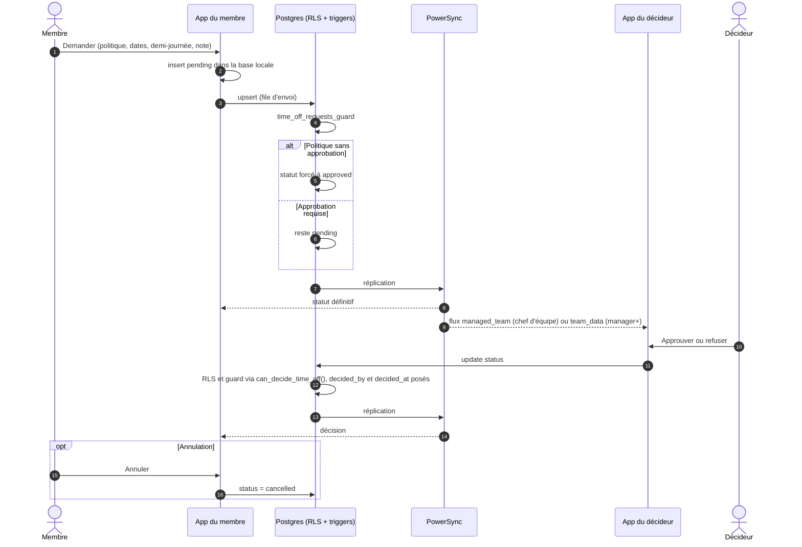

# Demande et décision d'absence

Une demande est une ligne de `time_off_requests` rattachée à une politique (`time_off_policies` : congés,
RTT…). La politique dit si une approbation est nécessaire (`requires_approval`) et qui décide
(`approvers`).

- **Qui décide** : manager+ toujours ; un chef d'équipe pour son périmètre si la politique a
  `approvers = managers_and_team_managers`.
- Le demandeur peut modifier une demande tant qu'elle est en attente, ou l'annuler ; il ne peut pas
  l'approuver lui-même (`insufficient_privilege`).
- Les jours sans heure (`start_date`, `end_date`) sont du texte `yyyy-MM-dd` côté app.

Sources : `app/lib/data/repositories/modules_repository.dart` (`requestTimeOff`, `decideRequest`,
`cancelRequest`), `app/lib/features/time_off/time_off_page.dart`,
`supabase/migrations/0009_team_managers.sql` (`can_decide_time_off`, `time_off_requests_guard`).
