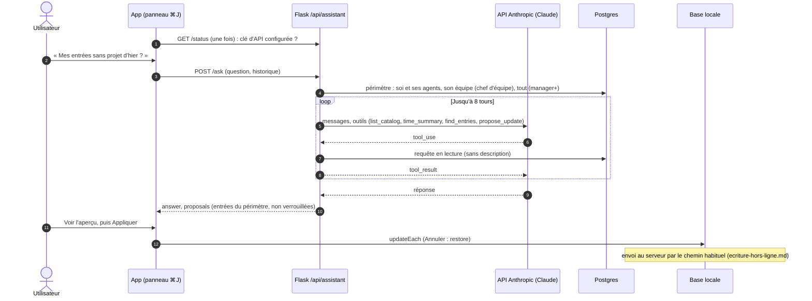

# Assistant « Demander à Clockifai »

L'assistant répond aux questions sur le temps passé (plan 13, lot 12). Flask appelle Claude (API Anthropic) avec des
outils en lecture seule ; Claude ne reçoit que des totaux et le référentiel, jamais les descriptions des entrées. Une
modification demandée revient comme **proposition** : rien n'est écrit côté serveur, l'app l'applique sur sa base
locale si la personne le décide.

- Modèle `ASSISTANT_MODEL` (`claude-opus-5-5`), effort `ASSISTANT_EFFORT` (`low`), repli serveur en cas de refus
  (`fallbacks: "default"`) ; 40 questions par heure et par personne.
- Sans `ANTHROPIC_API_KEY`, `/status` répond `enabled: false` et l'app cache l'assistant.

Sources : `services/app/routes/assistant.py`, `services/app/services/assistant.py`, `app/lib/features/assistant/`.
