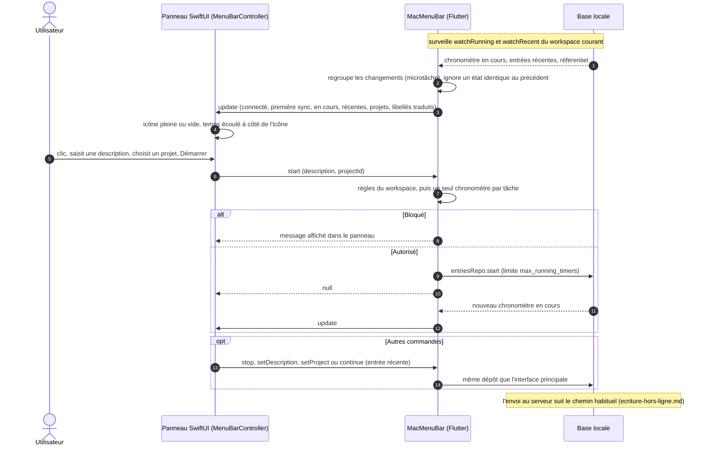

# Barre de menus macOS

L'icône Clockifai en haut à droite de l'écran ouvre un panneau natif SwiftUI. Ce panneau n'a **aucun accès
aux données** : le widget Flutter `MacMenuBar` lui pousse l'état par le canal `clockifai/menu_bar` et exécute
ses commandes sur la base locale, comme la barre du chronomètre. Tout marche hors ligne et fenêtre fermée
(le moteur Flutter et la synchronisation continuent tant que l'app tourne).

- Les commandes renvoient `null`, ou le message à afficher dans le panneau. Les libellés arrivent traduits
  depuis l'ARB avec l'état : le code Swift n'en contient aucun.
- Clic droit sur l'icône : ouvrir l'app, démarrage à l'ouverture de session (canal
  `clockifai/launch_at_login`, `SMAppService`, macOS 13+), quitter.
- `setProject` retire la tâche (propre à l'ancien projet) et recalcule facturable et taux.

Sources : `app/lib/features/timer/menu_bar.dart`, `app/macos/Runner/MenuBarController.swift`,
`app/macos/Runner/LaunchAtLogin.swift`, `app/test/` (pont simulé), `plans/06-macos-barre-de-menus.md`.
