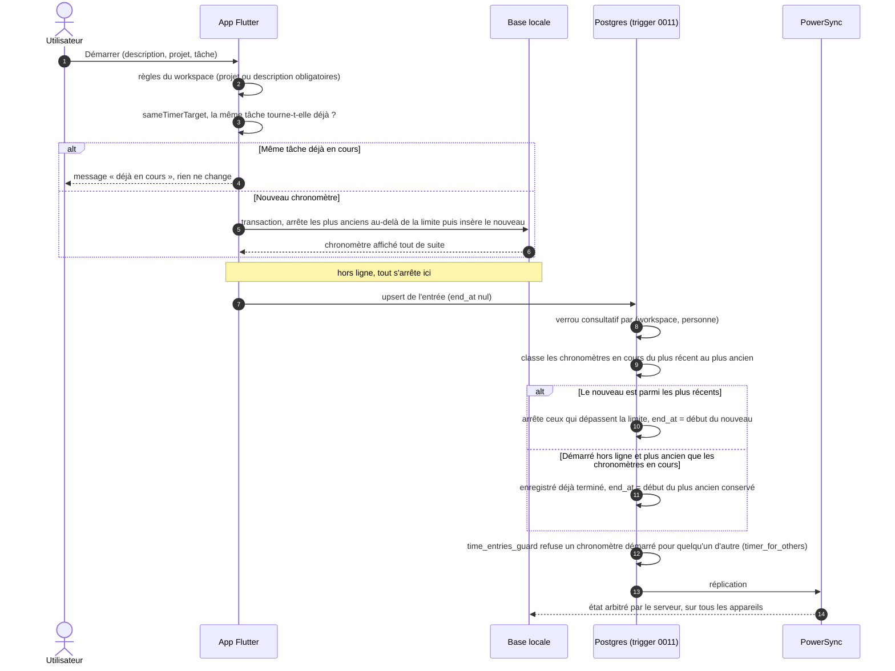

# Chronomètres simultanés

`workspaces.max_running_timers` fixe le nombre de chronomètres qu'une personne peut faire tourner en même
temps : 1 par défaut, 0 = illimité. La règle est « le plus récent gagne » : démarrer au-delà de la limite
arrête les plus anciens. L'app l'applique dans sa base locale (hors ligne compris) et le trigger
`time_entries_running_limit` l'applique de nouveau au serveur, qui tranche.

- **Un seul chronomètre par tâche** (même description, projet et tâche) : contrôle côté app seulement
  (`sameTimerTarget`, `alreadyRunningViolation`). La barre du chronomètre, la liste des entrées
  (« Continuer » devient « Arrêter ») et la barre de menus macOS le partagent.
- **Arrêt automatique** : APScheduler arrête toutes les 5 minutes les chronomètres qui dépassent
  `workspaces.auto_stop_after_hours`, à `start_at + limite` (voir `POST /api/jobs/auto-stop`).
- Le **kiosque** pointe la présence : un départ arrête tous les chronomètres en cours de la personne
  (voir `kiosque.md`).
- Avec une limite de 1, le comportement est celui de la migration 0004.

Sources : `app/lib/data/repositories/time_entry_repository.dart` (`start`, `sameTimerTarget`),
`app/lib/features/timer/timer_rules.dart`, `supabase/migrations/0011_parallel_timers.sql`,
`0009_team_managers.sql` (`time_entries_guard`), `services/app/jobs/tasks.py`.
