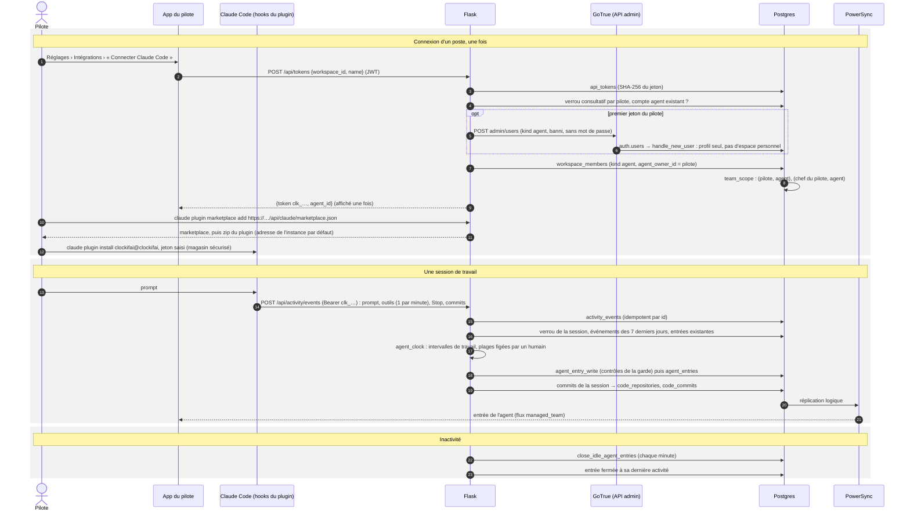

# Suivi de Claude Code : jeton, hooks, entrées de l'agent

Le temps de Claude est celui d'un membre « agent », un par pilote (« Claude · Yannick »). Les hooks Claude Code
du poste envoient les événements de chaque session ; Flask en recalcule les entrées de l'agent. Plan :
[10-suivi-claude-code.md](../../../plans/10-suivi-claude-code.md).

- Une entrée démarre au premier prompt ; une pause de moins de 10 minutes la prolonge ; passé ce délai, elle se
  ferme à la dernière activité. Une commande longue la prolonge grâce à sa durée (`duration_ms`).
- Le serveur ne touche jamais une entrée supprimée, arrêtée ou dont la fin a été corrigée à la main, ni le projet
  ou la description choisis dans l'app. `agent_entry_write` refuse aussi les entrées verrouillées, facturées,
  antérieures à `lock_entries_before` ou dans une période approuvée.
- Projet d'une entrée : tâche donnée dans la session (`session_task`), sinon projet de l'entrée précédente de la
  session, sinon règle personnelle (`POST /api/activity/rules`), sinon projet du dépôt.
- Un agent désactivé ou retiré par un admin : les événements sont gardés, aucune entrée n'est écrite.
- Le script du plugin n'envoie ni prompt, ni contenu des outils, ni transcription : session, dépôt, branche,
  dossier, durée de l'outil. Il lit la commande d'un outil `Bash` sur le poste pour repérer un `git commit` ; la
  session revendique les commits faits pendant sa commande (D13). Instance injoignable : file d'attente locale,
  renvoyée au prochain envoi réussi.
