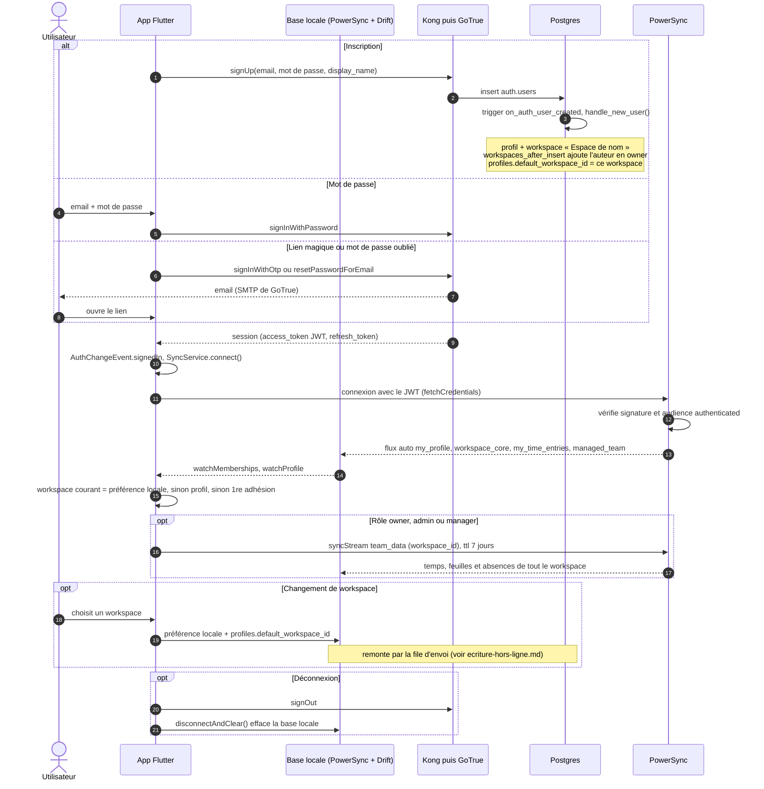

# Connexion, inscription et choix du workspace

L'app s'authentifie auprès de GoTrue (Supabase Auth, derrière Kong), puis présente le même JWT à PowerSync.
Toutes les données arrivent ensuite par la synchronisation : l'app ne lit jamais une table par PostgREST.

- Tant que la première synchronisation n'a livré aucune adhésion, l'app affiche « première synchronisation »
  (`SessionController.waitingForFirstSync`).
- À l'expiration du JWT, PowerSync demande de nouveaux identifiants (`invalidateCredentials` relance
  `refreshSession`).
- La déconnexion efface la base locale : un autre compte peut se connecter sur le même appareil.
- Une sync connectée sans point de contrôle depuis 10 minutes (2 minutes au retour au premier plan) est reconnectée
  par `SyncService.refreshIfStale` : `connect()` remplace la connexion en cours.

Sources : `app/lib/features/auth/login_page.dart`, `app/lib/core/session.dart`,
`app/lib/data/powersync/sync_service.dart`, `app/lib/data/powersync/connector.dart`,
`supabase/migrations/0001_core.sql`, `0002_auth_trigger.admin.sql`, `0006_personal_workspace_name.sql`,
`powersync/sync-config.yaml`.
