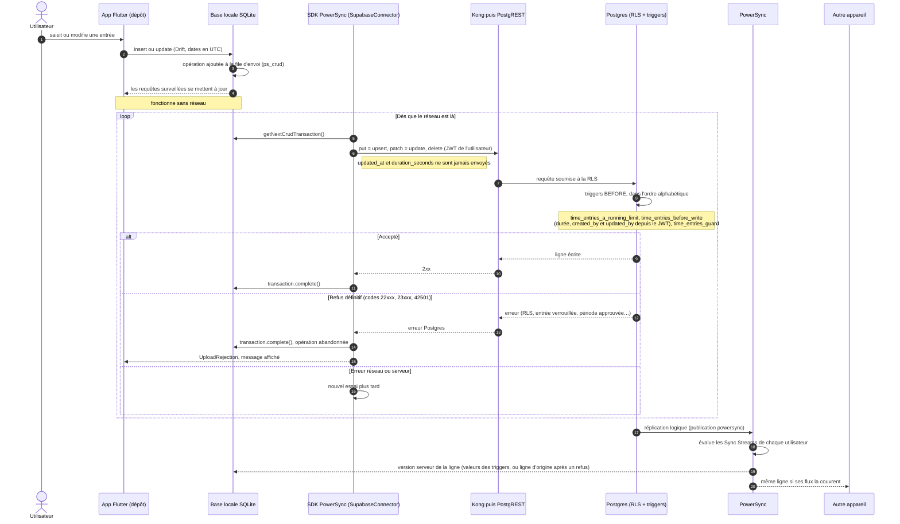

# Écriture hors ligne, envoi et réplication

Toute écriture de l'app (entrée de temps, projet, feuille, absence…) suit ce chemin. L'interface n'attend
jamais le réseau : elle écrit dans la base locale, qui met l'opération dans sa file d'envoi.

- **Le serveur fait foi.** Après un refus, la synchronisation suivante remet la donnée locale dans l'état du
  serveur. Les règles critiques sont dans les triggers, pas seulement dans l'app.
- Les écritures passent par **upsert** : la politique SELECT doit accepter la nouvelle ligne (migration 0005).
- Les lignes supprimées par soft delete (`deleted_at`) sortent des flux et disparaissent des bases locales.
  `time_entry_tags` est supprimé physiquement.
- Une colonne ajoutée à une table n'est répliquée qu'au prochain changement de ligne (d'où les migrations
  qui « touchent » les lignes).

Sources : `app/lib/data/powersync/connector.dart`, `app/lib/data/powersync/sync_service.dart`,
`app/lib/core/widgets/app_shell.dart`, `supabase/migrations/0003_rls.sql`, `0009_team_managers.sql`,
`0011_parallel_timers.sql`, `powersync/sync-config.yaml`.
