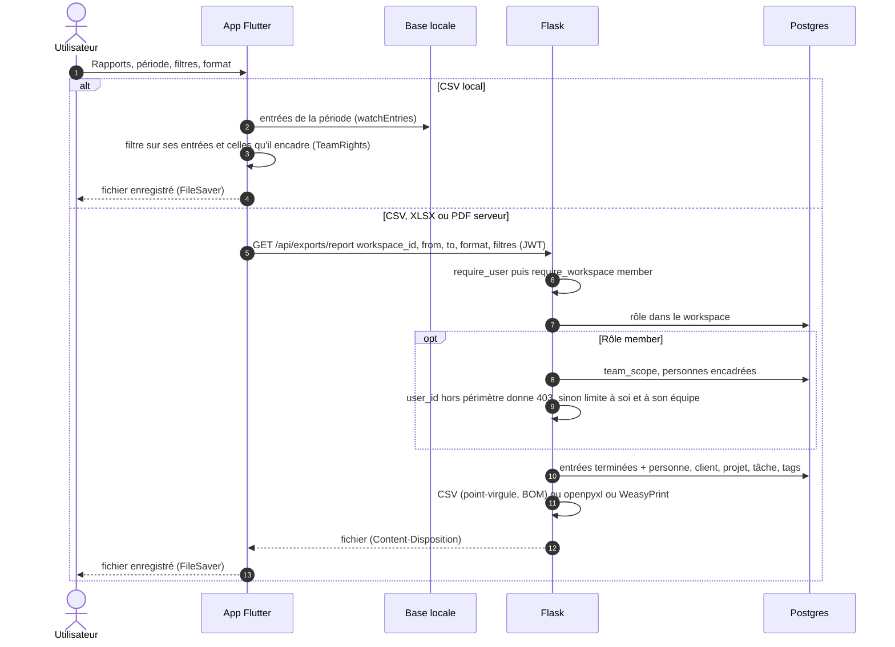

# Export d'un rapport

Deux chemins depuis l'écran Rapports :
- **CSV local** (`csv-local`) : calculé dans l'app à partir de la base locale, hors ligne, limité aux entrées
  que la personne voit et encadre ;
- **CSV, Excel, PDF serveur** : `GET /api/exports/report`, qui lit Postgres directement (réseau requis).

- Le connecteur psycopg contourne la RLS : le périmètre est recalculé dans la route (manager+ : tout le
  workspace ; membre : soi et son `team_scope`).
- Paramètres et formats : `GET /api/exports/report` dans `openapi.yaml`.

Sources : `app/lib/features/reports/reports_page.dart` (`_export`), `services/app/routes/exports.py`,
`services/app/services/exporters.py`.
