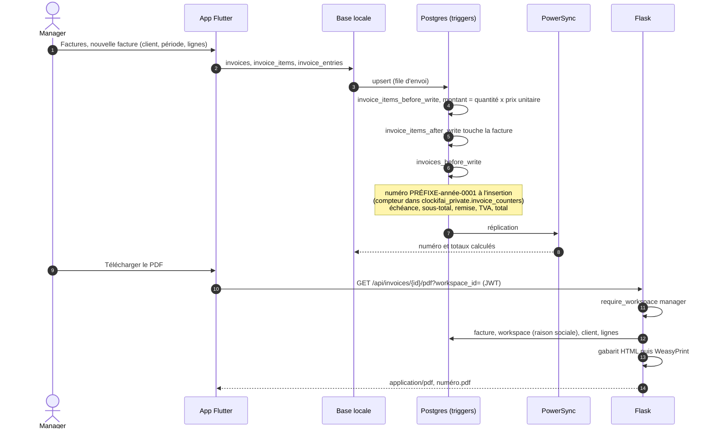

# Facture : création et PDF

La facture se construit dans l'app comme toute donnée (base locale, puis synchronisation) ; la base calcule
le numéro et les totaux. Seul le PDF passe par Flask.

- Une entrée de temps rattachée à une facture non annulée n'est plus modifiable (`invoiced_entry`,
  `time_entries_guard`).
- Facture inconnue ou supprimée : `404`. Un chef d'équipe (rôle `member`) reçoit `403`.

Sources : `app/lib/features/invoices/invoices_page.dart`, `services/app/routes/invoices.py`,
`supabase/migrations/0007_modules.sql`, `0008_private_schema.admin.sql`, `0009_team_managers.sql`.
