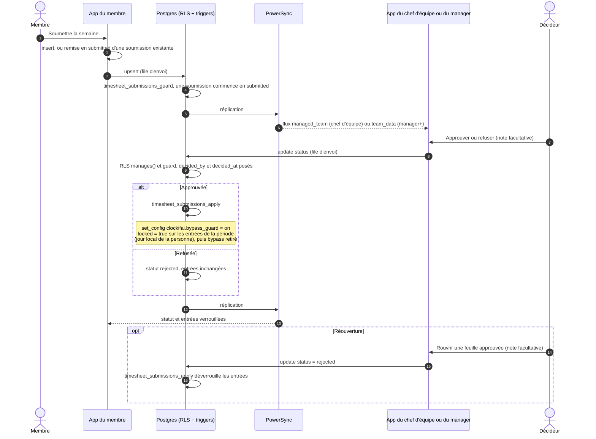

# Soumission et approbation d'une feuille de temps

La soumission est une ligne de `timesheet_submissions` (personne, période `period_start` → `period_end`,
statut). Les droits et les effets sont dans les triggers ; l'app ne fait qu'écrire la ligne dans sa base
locale.

- **Qui décide** : manager+ pour tout le workspace ; un chef d'équipe pour les personnes de son périmètre
  (`team_scope`), dont il est lui-même exclu. Le membre ne peut que soumettre ou retirer (`withdrawn`), et
  ne peut plus toucher une feuille approuvée.
- **Période approuvée** : `time_entries_guard` refuse d'y ajouter ou d'y déplacer une entrée
  (`approved_period`), et toute modification d'une entrée verrouillée (`locked_entry`), sauf pour un admin.
  L'app prévient avant, hors ligne compris (`isDayApproved`).
- Période et propriétaire d'une soumission sont immuables.

Sources : `app/lib/data/repositories/modules_repository.dart` (`submitPeriod`, `decideSubmission`),
`app/lib/features/approvals/`, `supabase/migrations/0007_modules.sql` (`timesheet_submissions_apply`,
`guard_bypassed`), `0009_team_managers.sql` (`timesheet_submissions_guard`, `time_entries_guard`).
