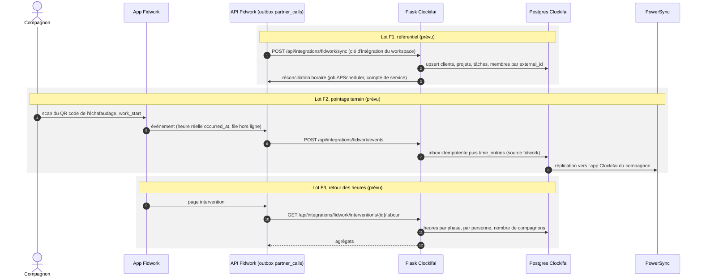

# Échanges Fidwork — prévu, non implémenté

> **Statut : en attente** (`plans/02-integration-fidwork.md`). Aucune des routes ci-dessous n'existe encore ;
> elles ne figurent pas dans `openapi.yaml`. Ce diagramme décrit la cible du plan et sera remplacé par le
> fonctionnement réel quand un lot sera livré.

Fidwork reste le registre des interventions, Clockifai le registre du temps. Fidwork pousse son référentiel
et les pointages par son outbox `partner_calls` ; Clockifai renvoie les heures par intervention.

Points à reprendre avant la relance (plan 02, § 9) : les écritures sans JWT contournent `time_entries_guard`
(périodes verrouillées, approuvées, facturées), et la limite de chronomètres interagit avec le kiosque et
l'app.
