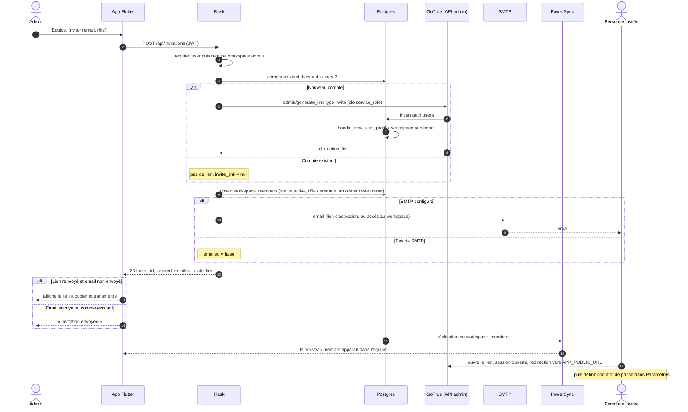

# Invitation dans un workspace

Seul un admin (owner ou admin) invite. L'invitation passe par Flask, qui a besoin du rôle service pour
créer un compte dans GoTrue : c'est une des rares actions qui exige le réseau.

- Un compte existant est ajouté directement, ou réactivé s'il avait quitté le workspace.
- GoTrue en erreur : `502` avec le détail. Voir `POST /api/invitations` dans `openapi.yaml`.

Sources : `services/app/routes/invitations.py`, `services/app/services/mailer.py`,
`app/lib/features/team/team_page.dart`.
