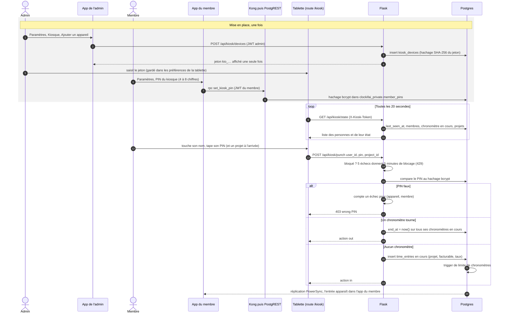

# Kiosque : pointage par PIN sur un appareil partagé

Une tablette à l'entrée de l'atelier ou de la base vie, ouverte sur la route `/kiosk` de l'app, sans compte
utilisateur. Elle s'authentifie par un jeton d'appareil ; chaque personne pointe avec son PIN.
Le kiosque exige le réseau : il parle à Flask, pas à la base locale.

- Les écritures de Flask n'ont pas de JWT : `created_by` reste vide et `time_entries_guard` ne s'applique pas
  (pas de contrôle de verrouillage ni de période approuvée sur un pointage kiosque).
- Le compteur d'échecs est en mémoire, dans l'unique worker gunicorn ; il repart de zéro au redémarrage.
- Révoquer l'appareil (`DELETE /api/kiosk/devices/{id}`) rend le jeton inutilisable immédiatement.
- Une personne sans PIN ne peut pas pointer : la tablette le signale avant d'appeler Flask (`has_pin`).

Sources : `services/app/routes/kiosk.py`, `app/lib/features/kiosk/kiosk_page.dart`,
`app/lib/features/settings/settings_page.dart`, `supabase/migrations/0008_private_schema.admin.sql`.
