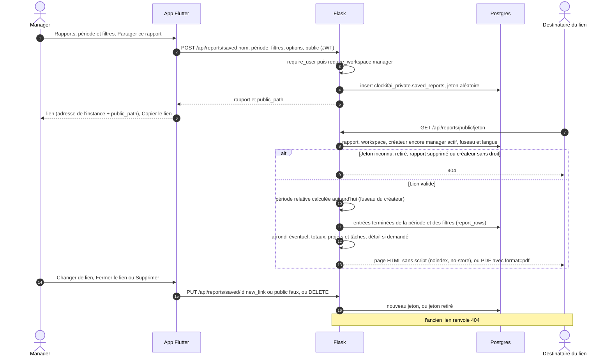

# Rapport partagé par lien public

Un manager enregistre le rapport affiché (période, filtres, options) et ouvre un lien public en lecture seule
(plan 18, lot 3). La personne qui reçoit le lien n'a pas de compte : Flask calcule la page à chaque ouverture, dans
le fuseau et la langue du créateur, tant que celui-ci est manager actif du workspace.

