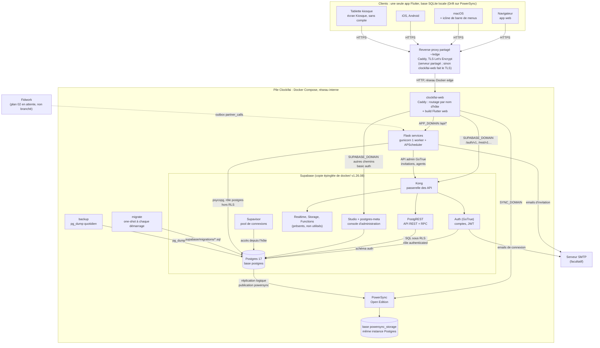
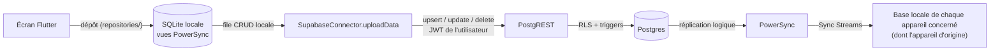

# Composants et flux

État actuel de la pile Clockifai. Déploiement local et production : [deploiement.md](deploiement.md) ;
tables, Sync Streams et droits : [donnees.md](donnees.md).

## Vue d'ensemble

Les trois noms DNS (`APP_DOMAIN`, `SUPABASE_DOMAIN`, `SYNC_DOMAIN`) arrivent tous sur `clockifai-web`, qui route
selon l'hôte (`deploy/Caddyfile`) :

| Domaine | Chemin | Destination |
|---|---|---|
| `APP_DOMAIN` | `/api/*` | Flask (`services:5000`) |
| `APP_DOMAIN` | `/guide/*` | guide utilisateur (`docs/guide` monté en lecture seule sur `/srv/guide`, vidéos comprises) |
| `APP_DOMAIN` | le reste | build Flutter web (`/srv/web`, repli sur `index.html`) |
| `SUPABASE_DOMAIN` | `/auth/v1/*`, `/rest/v1/*`, `/graphql/v1`, `/realtime/v1/*`, `/storage/v1/*`, `/functions/v1/*`, `/mcp`, `/sso/*` | Kong (`kong:8000`) |
| `SUPABASE_DOMAIN` | le reste | Studio (`studio:3000`), réseau local seulement (`STUDIO_ALLOWED_IPS`, sinon 403), puis basic auth `DASHBOARD_USERNAME` / `DASHBOARD_PASSWORD` |
| `SYNC_DOMAIN` | tout | PowerSync (`powersync:8080`) |

L'app web appelle Flask sur sa propre origine (`SERVICES_URL` vide dans l'image) ; les apps natives utilisent
`https://<APP_DOMAIN>` (`make app-config-prod`).

## Composants

| Composant | Conteneur | Image / version | Rôle | Port interne | Exposé |
|---|---|---|---|---|---|
| Caddy + app web | `clockifai-web` | construite par `app/Dockerfile` (Flutter 3.47.0, puis `caddy:2-alpine`) | TLS (ou HTTP derrière `~/edge`), routage par hôte, fichiers du build web et du guide | 80, 443 | profil prod : 80/443 sur l'hôte, ou réseau `edge` |
| Kong | `supabase-kong` | `kong/kong:3.9.3` | passerelle des API Supabase (clés `anon` / `service_role`) ; en local, Studio sur `/` en basic auth | 8000, 8443 | local : 8000, 8443 |
| Auth | `supabase-auth` | `supabase/gotrue:v2.189.0` | comptes, JWT HS256, liens d'invitation, emails | 9999 | via Kong `/auth/v1` |
| PostgREST | `supabase-rest` | `postgrest/postgrest:v14.12` | API REST sur le schéma `public` : écritures des clients (upsert), RPC `set_kiosk_pin` | 3000 | via Kong `/rest/v1` |
| Realtime | `realtime-dev.supabase-realtime` | `supabase/realtime:v2.102.3` | fourni avec Supabase, non utilisé par l'app | 4000 | via Kong |
| Storage, imgproxy | `supabase-storage`, `supabase-imgproxy` | `supabase/storage-api:v1.60.4`, `darthsim/imgproxy:v3.30.1` | non utilisés par l'app | 5000 | via Kong |
| Edge Functions | `supabase-edge-functions` | `supabase/edge-runtime:v1.74.0` | non utilisé | 9000 | via Kong |
| Studio, meta | `supabase-studio`, `supabase-meta` | `supabase/studio:2026.08.03-sha-022b374`, `supabase/postgres-meta:v0.96.6` | console : comptes, données, SQL | 3000, 8080 | local : Kong `/` ; prod : `SUPABASE_DOMAIN` hors API |
| Postgres | `supabase-db` | `supabase/postgres:17.6.1.136` | bases `postgres` (schéma, RLS, triggers) et `powersync_storage` ; `wal_level = logical` | 5432 | non publié |
| Supavisor | `supabase-pooler` | `supabase/supavisor:2.9.5` | pool pour les connexions depuis l'hôte (session 5432, transaction 6543) | 5432, 6543 | local : 5432, 6543 |
| PowerSync | `clockifai-powersync` | `journeyapps/powersync-service:1.26.1` (`POWERSYNC_VERSION`) | réplication logique → buckets → clients ; Sync Streams de `powersync/sync-config.yaml` | 8080 | local : 8080 ; prod : `SYNC_DOMAIN` |
| Flask | `clockifai-services` | construite par `services/Dockerfile` (`python:3.12-slim-bookworm`, uv, gunicorn) | exports, factures PDF (WeasyPrint), invitations, kiosque, jetons personnels et temps des agents Claude, tâches planifiées | 5000 | local : 5050 ; prod : `APP_DOMAIN/api` |
| migrate | `clockifai-migrate` | `postgres:17-alpine` | rejoue `supabase/migrations/` (suivi `clockifai_meta.schema_migrations`) avant PowerSync et Flask | — | — |
| backup | `clockifai-backup` | `postgres:17-alpine` | profil prod : `pg_dump` quotidien à `BACKUP_HOUR`, rétention `BACKUP_KEEP_DAYS` (14 j), dans `deploy/backups/` | — | — |

Ports « exposés » ci-dessus : publiés sur l'hôte par les fichiers compose de base. Derrière `~/edge`, l'override
`docker-compose.edge.yml` les retire tous (voir [deploiement.md](deploiement.md)).

Tâches planifiées de Flask (`services/app/jobs/`, un seul worker donc un seul scheduler) :

- `auto_stop_long_timers` toutes les `JOB_AUTOSTOP_INTERVAL_MIN` minutes (5) : arrête à `start_at + auto_stop_after_hours`
  les chronomètres qui dépassent la limite du workspace (0 = jamais) ;
- `purge_soft_deleted` chaque jour à 04:15 UTC : supprime physiquement les lignes soft-deleted depuis plus de
  `JOB_PURGE_DELETED_AFTER_DAYS` jours (30) dans `time_entries`, `tasks`, `projects`, `clients`, `tags`,
  `workspace_members`, `workspaces` ;
- `close_idle_agent_entries` chaque minute : recalcule les sessions Claude Code dont une entrée d'agent tourne
  sans activité depuis 10 minutes, ce qui la ferme à sa dernière activité ;
- `purge_activity_events` chaque jour à 04:30 UTC : supprime les événements bruts reçus il y a plus de 30 jours.

## Chemin d'une écriture

1. L'UI ne parle jamais à Supabase pour les données : elle écrit dans la base locale par les dépôts de
   `app/lib/data/repositories/`, ce qui fonctionne hors ligne.
2. PowerSync met l'opération en file ; `SupabaseConnector.uploadData` la rejoue par PostgREST, une transaction à la
   fois : insertion en `upsert` (sans les `null` ni les colonnes serveur `updated_at`, `duration_seconds`), mise à jour
   en `update`, suppression en `delete`.
3. Postgres applique la RLS puis les triggers (verrouillage, limite de chronomètres, garde des rôles, approbations,
   numérotation de facture…, voir [donnees.md](donnees.md)). Un refus définitif (codes `22…`, `23…`, `42501`) est
   abandonné et signalé à l'utilisateur ; la donnée locale est corrigée par la synchronisation suivante. Une erreur
   réseau ou serveur temporaire est réessayée.
4. Le changement validé part dans la réplication logique (publication `powersync`, rôle `powersync_role`
   `BYPASSRLS`) ; PowerSync recalcule les buckets et le redescend à tous les clients dont les Sync Streams
   couvrent la ligne. Une ligne soft-deleted sort des flux et disparaît des bases locales.

Flask n'écrit pas par ce chemin : il se connecte directement à Postgres (rôle `postgres`, hors RLS). Sans JWT,
`auth.uid()` est nul et les gardes des triggers laissent passer ; Flask fait donc ses propres contrôles
(`require_workspace`, PIN du kiosque). Les triggers qui ne dépendent pas de l'utilisateur (limite de chronomètres,
calcul des durées, numérotation) s'appliquent quand même.

## Authentification

- **Comptes** : Supabase Auth (email + mot de passe, ou lien reçu par email). Le JWT d'accès (HS256, secret
  `JWT_SECRET`, audience `authenticated`) sert partout :
  - PostgREST l'applique à la RLS (`auth.uid()`) ;
  - PowerSync l'accepte tel quel (`client_auth.supabase`, `powersync/service.yaml`) : `fetchCredentials` renvoie le
    jeton de la session Supabase ;
  - Flask le vérifie (`services/app/auth.py`, HS256 ou JWKS), puis contrôle l'appartenance active au workspace
    demandé et le rôle minimal (`require_workspace`).
- **Kiosque** : la tablette n'a pas de compte. Un admin crée un appareil (`POST /api/kiosk/devices`) ; le jeton
  `kio_…` est affiché une seule fois, seul son SHA-256 est stocké (`kiosk_devices.token_hash`). L'appareil envoie
  `X-Kiosk-Token` ; chaque pointage exige le PIN du membre (4 à 8 chiffres, haché bcrypt dans
  `clockifai_private.member_pins`, posé par la RPC `set_kiosk_pin`). Anti force brute en mémoire : 5 échecs bloquent
  le couple (appareil, membre) 5 minutes.
- **Studio** : basic auth (`DASHBOARD_USERNAME` / `DASHBOARD_PASSWORD`), par Kong en local, par Caddy en prod,
  où il n'est en plus accessible que depuis le réseau local (`STUDIO_ALLOWED_IPS`).
- **Jeton personnel** : `Authorization: Bearer clk_…`, créé par un membre pour un poste (`POST /api/tokens`),
  utilisé par les hooks Claude Code, l'extension VSCode et le MCP. Seul son SHA-256 est stocké
  (`clockifai_private.api_tokens`) ; il porte un workspace, et il est refusé s'il est révoqué ou si son
  propriétaire n'est plus membre actif. Les routes `/api/activity/*` acceptent aussi le JWT de l'app.
- **Service** : Flask appelle l'API admin GoTrue avec la clé `service_role` (invitations, comptes des agents
  Claude) ; la route `POST /api/jobs/purge-deleted` n'accepte qu'un JWT `service_role`.
- **Barre de menus macOS** : le panneau natif SwiftUI n'a accès à aucune donnée ni à aucun jeton ; il reçoit l'état
  et renvoie ses commandes par le canal `clockifai/menu_bar`, exécutées par l'app Flutter sur la base locale.
