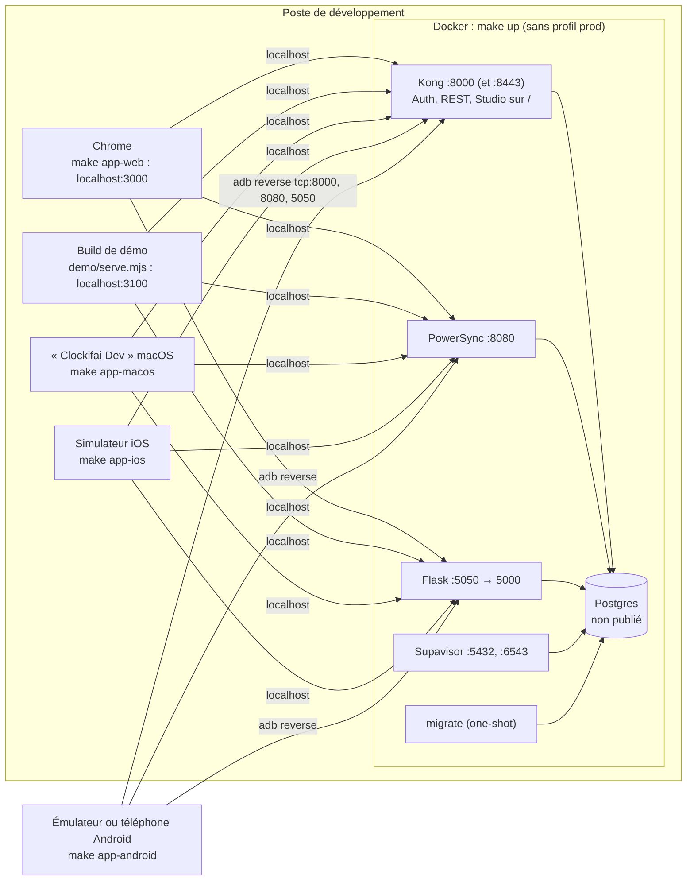
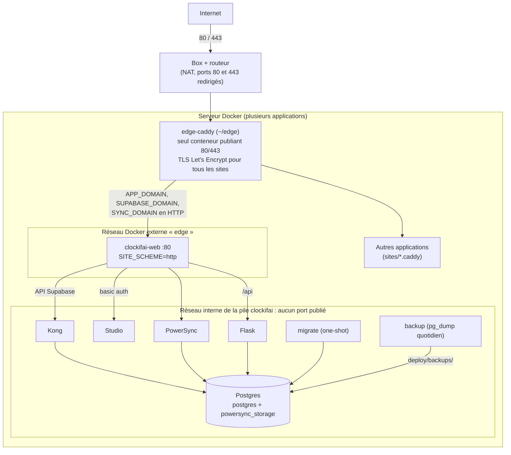

# Déploiement

Deux configurations du même `deploy/docker-compose.yml` (qui inclut `supabase/docker/docker-compose.yml`) :
la pile locale de développement, et la production (profil `prod`), autonome ou derrière un reverse proxy partagé.
Composants détaillés : [composants.md](composants.md). Procédures d'exploitation : `docs/exploitation.md`.

## Pile locale (développement)

- `make up` démarre Supabase, PowerSync, Flask et rejoue les migrations ; Caddy et la sauvegarde ne tournent pas
  (profil `prod`).
- Tous les clients utilisent la même `app/config/local.json` (`make app-config`, depuis `deploy/.env`) :
  `SUPABASE_URL=http://localhost:8000`, `POWERSYNC_URL=http://localhost:8080`, `SERVICES_URL=http://localhost:5050`.
  Android y accède grâce à `adb reverse` (ports de l'appareil renvoyés vers ceux du Mac).
- Flask en local répond sur 5050 : le port 5000 du Mac est pris par AirPlay.
- Studio : `http://localhost:8000/` (basic auth `DASHBOARD_USERNAME` / `DASHBOARD_PASSWORD`). `make psql` ouvre psql
  dans le conteneur `db`.
- CORS : en local l'app (3000) et Flask (5050) n'ont pas la même origine, `CORS_ORIGINS` liste les origines
  autorisées. En prod l'app web et `/api` partagent l'origine `APP_DOMAIN`.

## Production sur serveur partagé

- **Proxy partagé** : `deploy/edge/` est un modèle copié hors du dépôt (`~/edge`) et lancé une fois par serveur
  (`docker network create edge`). Chaque application rejoint le réseau `edge` et ajoute un fichier
  `sites/<app>.caddy` ; pour Clockifai, les trois noms vont à `clockifai-web:80`.
- **Override** : sur le serveur, `deploy/docker-compose.override.yml` (copie non versionnée de
  `docker-compose.edge.yml`, prise en compte par le `Makefile`) retire les ports publiés de Kong, Supavisor, PowerSync,
  Flask et `clockifai-web`, passe le Caddy interne en HTTP et le raccorde au réseau `edge`. Rien n'est exposé sur le
  LAN, et pas de conflit avec les ports des autres piles.
- **Sans override** (serveur dédié), `clockifai-web` publie 80/443 et obtient lui-même ses certificats
  (`SITE_SCHEME=https`, `ACME_EMAIL`). Les ports de développement (8000, 8443, 5432, 6543, 8080, 5050) restent
  alors publiés sur l'hôte : à filtrer par le pare-feu.
- **Démarrage** (`make prod-up`, soit `docker compose --profile prod up -d --build`) : construit l'image web (SDK Flutter dans l'image,
  URLs publiques et clé anon figées dans le bundle) et l'image Flask ; `migrate` rejoue les migrations, puis PowerSync
  et Flask démarrent une fois les migrations réussies.
- **Livraison** : `make deploy HOST=user@ip` copie par rsync les fichiers suivis par git (jamais `deploy/.env`, ni
  les données), puis lance `make prod-up` sur le serveur. Les secrets de production sont générés sur le serveur
  (`make env`) et n'en sortent pas ; `make app-config-prod` n'en rapatrie que les valeurs publiques.
- **Guide utilisateur** : `docs/guide/` arrive avec `make deploy` et est monté en lecture seule dans `clockifai-web`
  (`/guide/`). Ses vidéos, hors git, partent à part : `make guide-videos` puis `make guide-publish HOST=user@ip`
  (rsync vers `docs/guide/videos/` sur le serveur, que `make deploy` ne touche pas).

### Données persistantes

| Donnée | Emplacement | Sauvegarde |
|---|---|---|
| Postgres (bases `postgres` et `powersync_storage`) | `supabase/docker/volumes/db/data/` (montage) | `pg_dump` de `postgres` ; `powersync_storage` se reconstruit par réplication |
| Fichiers Storage (non utilisé) | `supabase/docker/volumes/storage/` | — |
| Configuration Postgres, cache Deno | volumes `db-config`, `deno-cache` | — |
| Certificats Caddy | volumes `caddy-data`, `caddy-config` (ou ceux de `~/edge`) | — |
| Sauvegardes | `deploy/backups/clockifai-AAAAMMJJ-HHMMSS.dump` | à copier hors du serveur |
| Vidéos du guide | `docs/guide/videos/` (hors git) | inutile : se retournent avec `demo/` |
| Secrets | `deploy/.env` (jamais versionné ni copié par `make deploy`) | à conserver à part |

## Variantes de l'application

Debug et Release sont deux applications distinctes (identifiants différents, donc bases locales et sessions
séparées) :

| Plateforme | Debug : « Clockifai Dev », pile locale | Release : « Clockifai », production |
|---|---|---|
| Web | `make app-web` (`flutter run`, port 3000) ; build de démo sur 3100 | image `clockifai-web`, servie sur `APP_DOMAIN` |
| macOS | `com.kysoe.clockifai.dev` (`AppInfo.xcconfig`), `make app-macos` | `com.kysoe.clockifai`, `app/config/prod.json` ; `make app-dist-macos` (Developer ID) ou `app-dist-macos-testflight` |
| iOS | `com.kysoe.clockifai.dev` (`project.pbxproj`, `APP_DISPLAY_NAME`), `make app-ios` | `com.kysoe.clockifai` ; `make app-dist-ios` (App Store Connect / TestFlight) |
| Android | `com.kysoe.clockifai.dev` (`applicationIdSuffix`, `resValue app_name`), `make app-android` | `com.kysoe.clockifai` ; `make app-dist-android` (.aab Google Play) |

Les builds Release lisent `app/config/prod.json` (`make app-config-prod HOST=…`), avec
`SERVICES_URL=https://<APP_DOMAIN>`.
