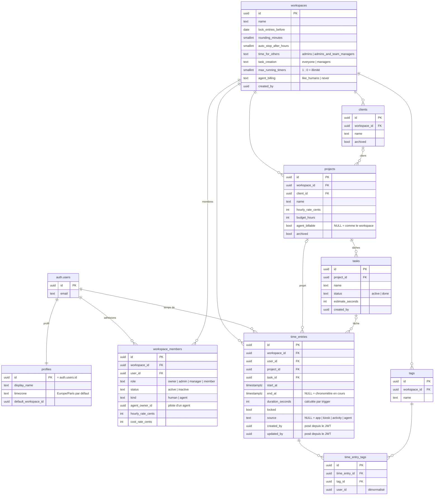
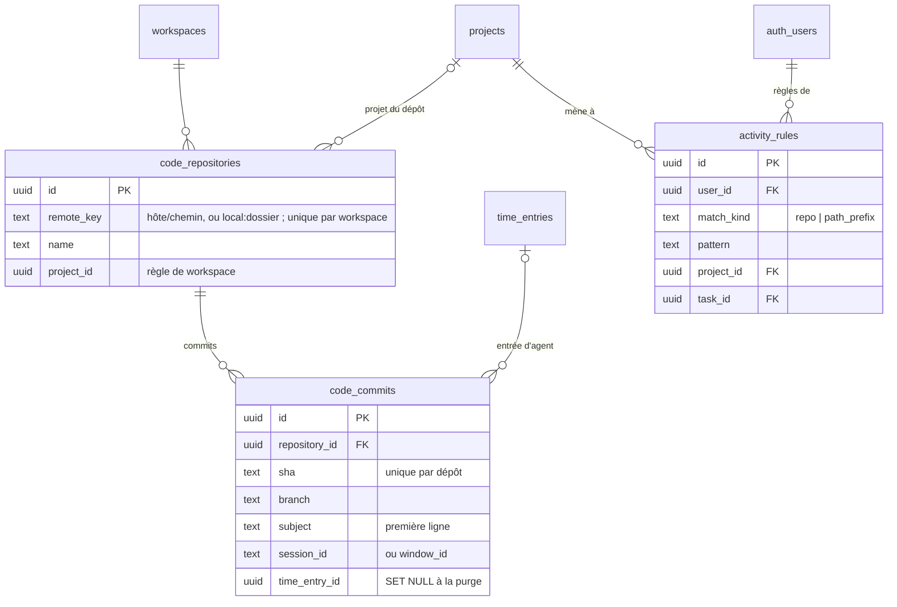

# Données, synchronisation et droits

Schéma Postgres issu de `supabase/migrations/` (0000 à 0013), Sync Streams de `powersync/sync-config.yaml`, droits
appliqués par la RLS et les triggers. `app/lib/core/team_rights.dart` (`TeamRights`) reproduit les règles d'équipe
pour l'affichage ; la RLS reste la seule vraie barrière. Composants : [composants.md](composants.md).

## Conventions

- Toutes les tables métier sont dans `public`, portent `workspace_id` (→ `workspaces`), `created_at`, `updated_at`
  (trigger `set_updated_at` ou équivalent) et, sauf exception ci-dessous, `deleted_at` (soft delete). `user_id`
  référence toujours `auth.users`.
- Suppression physique (pas de `deleted_at`) : `time_entry_tags`, `user_group_members`, `team_manager_assignments`,
  `invoice_entries`. `team_scope` est une table dérivée, écrite seulement par `refresh_team_scope()`.
- Les lignes soft-deleted sortent des Sync Streams (donc des bases locales) ; Flask les purge après 30 jours
  (`purge_soft_deleted`, voir [composants.md](composants.md)).
- Toutes les tables de `public` sont dans la publication logique `powersync` et lisibles par `powersync_role`
  (`BYPASSRLS`) : le filtrage par utilisateur se fait dans les Sync Streams.

## Schéma relationnel

### Comptes, référentiel et temps

### Modules : approbations, absences, planning, factures, équipes, kiosque

```mermaid
erDiagram
  workspaces ||--o{ timesheet_submissions : ""
  workspaces ||--o{ time_off_policies : ""
  time_off_policies ||--o{ time_off_requests : "demandes"
  time_off_policies ||--o{ time_off_allowances : "soldes"
  workspaces ||--o{ holidays : ""
  workspaces ||--o{ schedule_assignments : ""
  projects |o--o{ schedule_assignments : "projet"
  workspaces ||--o{ invoices : ""
  clients |o--o{ invoices : "client"
  invoices ||--o{ invoice_items : "lignes"
  invoices ||--o{ invoice_entries : "temps facturé"
  time_entries ||--o{ invoice_entries : ""
  workspaces ||--o{ user_groups : ""
  user_groups ||--o{ user_group_members : "membres"
  user_groups |o--o{ team_manager_assignments : "groupe encadré"
  workspaces ||--o{ team_manager_assignments : ""
  workspaces ||--o{ team_scope : "périmètre dérivé"
  workspaces ||--o{ kiosk_devices : ""

  timesheet_submissions {
    uuid id PK
    uuid user_id FK
    date period_start "unique par workspace et utilisateur"
    date period_end
    text status "submitted | approved | rejected | withdrawn"
    uuid decided_by
  }
  time_off_policies {
    uuid id PK
    text name
    text unit "days | hours"
    numeric annual_allowance "NULL = illimité"
    bool requires_approval
    text approvers "managers | managers_and_team_managers"
  }
  time_off_requests {
    uuid id PK
    uuid user_id FK
    uuid policy_id FK
    date start_date
    date end_date
    numeric amount
    text status "pending | approved | rejected | cancelled"
  }
  time_off_allowances {
    uuid id PK
    uuid user_id FK
    uuid policy_id FK
    int year
    numeric allowance
  }
  holidays {
    uuid id PK
    text name
    date date
  }
  schedule_assignments {
    uuid id PK
    uuid user_id FK
    uuid project_id FK
    date start_date
    date end_date
    numeric hours_per_day
  }
  invoices {
    uuid id PK
    uuid client_id FK
    text number "attribué par le serveur"
    text status "draft | sent | paid | void"
    date issue_date
    bigint total_cents "calculé par trigger"
  }
  invoice_items {
    uuid id PK
    uuid invoice_id FK
    numeric quantity
    bigint unit_price_cents
    bigint amount_cents "calculé par trigger"
  }
  invoice_entries {
    uuid id PK
    uuid invoice_id FK
    uuid time_entry_id FK
  }
  user_groups {
    uuid id PK
    text name
  }
  user_group_members {
    uuid id PK
    uuid group_id FK
    uuid user_id FK
  }
  team_manager_assignments {
    uuid id PK
    uuid manager_id FK
    uuid user_id FK "ou group_id, exactement un"
    uuid group_id FK
  }
  team_scope {
    uuid id PK
    uuid manager_id FK
    uuid user_id FK "jamais le chef lui-même"
  }
  kiosk_devices {
    uuid id PK
    text name
    text token_hash "SHA-256 du jeton"
    timestamptz last_seen_at
  }
```

### Agents Claude et activité de code (0012, 0013)

Le temps de Claude est celui d'un membre `kind = 'agent'`, un par pilote (`agent_owner_id`), dont les entrées sont
des `time_entries` ordinaires (`source = 'agent'`) écrites par le serveur seulement
([plan 10](../../plans/10-suivi-claude-code.md)).

`code_repositories` et `code_commits` sont lisibles par les membres, écrites par le serveur seulement.
`activity_rules` sont personnelles : créées par le serveur, le client ne peut que les retirer (`deleted_at`).

### Hors du schéma `public`

| Schéma | Table | Contenu | Accès |
|---|---|---|---|
| `clockifai_private` | `member_pins` | PIN kiosque haché (bcrypt) par `(workspace_id, user_id)` | RPC `set_kiosk_pin` / `has_kiosk_pin` (security definer) et Flask ; ni PostgREST, ni réplication |
| `clockifai_private` | `invoice_counters` | dernier numéro de facture par `(workspace_id, year)` | trigger `invoices_before_write` |
| `clockifai_private` | `api_tokens` | jetons personnels `clk_…` hachés (SHA-256), un par poste, pour un utilisateur et un workspace | Flask |
| `clockifai_private` | `activity_events` | événements bruts des hooks Claude Code et de l'extension VSCode, sans contenu de prompt ni de fichier ; purgés après 30 jours | Flask |
| `clockifai_private` | `agent_entries` | par entrée d'agent : session, dépôt, dernière activité, et valeurs écrites par le serveur (pour repérer ce qu'un humain a retouché) | Flask |
| `clockifai_meta` | `schema_migrations` | migrations appliquées | `deploy/migrate.sh` |

Les tables privées se créent par une migration `*.admin.sql` : `postgres` n'a que `usage` sur `clockifai_private`.

`profiles` est créé par trigger à l'inscription (`handle_new_user` sur `auth.users`), avec un workspace personnel
« Espace de <nom> » dont l'utilisateur devient propriétaire (`workspaces_after_insert`). Un compte d'agent
(`kind = 'agent'` dans ses métadonnées) n'a qu'un profil, pas de workspace personnel. Un changement de nom ou
d'email du profil est recopié dans ses adhésions (`profiles_after_update`).

## Sync Streams

Ce que chaque utilisateur connecté reçoit dans sa base locale. Toutes les requêtes excluent `deleted_at` non nul.
« Membre actif » = ligne `workspace_members` avec `status = 'active'` et `deleted_at` nul.

| Flux | Souscription | Priorité | Tables | Filtre |
|---|---|---|---|---|
| `my_profile` | automatique | 0 | `profiles` | sa propre ligne |
| `workspace_core` | automatique | 1 | `workspaces`, `workspace_members`, `clients`, `projects`, `tasks`, `tags`, `time_off_policies`, `holidays`, `user_groups`, `user_group_members`, `team_manager_assignments`, `team_scope` | tous les workspaces où l'on est membre actif |
| `my_time_entries` | automatique | 2 | `time_entries`, `time_entry_tags`, `timesheet_submissions`, `time_off_requests`, `time_off_allowances`, `schedule_assignments` | `user_id` = soi, dans tous ses workspaces |
| `managed_team` | automatique | 3 | `time_entries`, `time_entry_tags`, `timesheet_submissions`, `time_off_requests`, `time_off_allowances` | lignes des collaborateurs encadrés : jointure sur `team_scope` par `(workspace_id, user_id)` avec `manager_id` = soi, rien d'un autre workspace du collaborateur |
| `team_data` | à la demande, paramètre `workspace_id` | 3 | `time_entries`, `time_entry_tags`, `timesheet_submissions`, `time_off_requests`, `time_off_allowances`, `schedule_assignments`, `invoices`, `invoice_items`, `invoice_entries` | tout le workspace demandé, si l'on y a un rôle autre que `member` |

`SessionController` souscrit `team_data` pour le workspace courant quand le rôle est owner, admin ou manager, et
change de souscription avec le workspace. Ne sont jamais synchronisés : `kiosk_devices` (géré par Flask),
`code_repositories` et `code_commits` (lus en ligne), les schémas
`clockifai_private` et `clockifai_meta`, `auth.*`.

## Matrice des droits

« Chef d'équipe » n'est pas un rôle : c'est un membre (de rôle quelconque) qui encadre des personnes ou des groupes
(`team_manager_assignments`), son périmètre étant matérialisé dans `team_scope` (membres actifs, jamais lui-même).
La colonne « Chef d'équipe » décrit ce qu'il gagne sur son périmètre en plus de son rôle. Helpers SQL :
`is_member`, `is_manager` (owner, admin, manager), `is_admin` (owner, admin), `manages(wid, uid)` (manager+ ou
`team_scope`), `can_edit_others_time`, `can_decide_time_off`, `can_create_task`.

| Action | Membre | Chef d'équipe (son périmètre) | Manager | Admin | Propriétaire |
|---|---|---|---|---|---|
| Lire le référentiel (membres, projets, tâches, clients, tags, politiques d'absence, jours fériés, groupes, chefs d'équipe) | oui | oui | oui | oui | oui |
| Voir les taux horaires et de coût des membres | oui ¹ | oui | oui | oui | oui |
| Saisir et modifier son propre temps | oui, hors verrous ² | oui, hors verrous | oui, hors verrous | oui, verrous ignorés | oui, verrous ignorés |
| Démarrer un chronomètre pour quelqu'un d'autre | non | non | non | non ³ | non ³ |
| Voir le temps, les feuilles, absences et soldes des autres | non | oui | tout le workspace | tout le workspace | tout le workspace |
| Saisir et modifier le temps des autres | non | si `time_for_others = admins_and_team_managers` | tout le workspace, si `admins_and_team_managers` | oui | oui |
| Poser ou retirer le verrou d'une entrée (`locked`) | non | non | non | oui | oui |
| Approuver, refuser, rouvrir une feuille de temps | non (soumettre, retirer la sienne) | oui, jamais la sienne | oui, la sienne comprise | oui | oui |
| Demander une absence | pour soi | pour soi | pour n'importe qui | pour n'importe qui | pour n'importe qui |
| Approuver ou refuser une absence | non (modifier ou annuler la sienne en attente) | si la politique a `approvers = managers_and_team_managers` | oui, les siennes comprises | oui | oui |
| Créer une tâche sur un projet actif | si `task_creation = everyone`, puis la renommer seulement | idem | oui | oui | oui |
| Gérer clients, projets, tâches, tags | non | non | oui | oui | oui |
| Planning : voir | ses affectations | ses affectations | tout | tout | tout |
| Planning : affecter | non | non | oui | oui | oui |
| Factures : voir, créer, PDF | non | non | oui | oui | oui |
| Exporter un rapport (`/api/exports/report`) | ses données | + son périmètre | tout | tout | tout |
| Politiques d'absence, soldes, jours fériés | non | non | non | oui | oui |
| Groupes et chefs d'équipe | non | non | non | oui | oui |
| Membres : inviter, rôle, statut, taux, retrait | non (nom affiché sur sa propre ligne) | non | non | oui | oui |
| Paramètres du workspace (verrouillage, arrondi, règles…) | non | non | non | oui | oui |
| Appareils kiosque, déclenchement de l'arrêt automatique | non | non | non | oui | oui |
| Supprimer définitivement le workspace (`DELETE`) | non | non | non | non | oui |

¹ `members_select` autorise tout membre, et `workspace_core` synchronise `workspace_members` en entier.
² Verrous : entrée `locked`, date antérieure à `lock_entries_before`, période approuvée, entrée facturée.
³ Trigger `time_entries_guard` : refusé pour tout utilisateur connecté, admins compris.

**Agents Claude.** Un agent est un membre de rôle `member`, créé par le serveur seulement, qui ne se connecte
jamais. `team_scope` contient aussi (pilote, agent) et (chef d'équipe du pilote, agent) : le pilote et ses chefs
lisent le temps de l'agent. Le pilote le corrige et le supprime (`pilots_agent`), même si
`time_for_others = admins`, mais personne ne crée d'entrée d'agent depuis l'app, admins compris. L'agent suit son
pilote quand celui-ci est désactivé ou retiré, jamais dans l'autre sens.

`TeamRights` reproduit `manages` (`manages`), `can_edit_others_time` (`canEditTimeOf`), l'approbation des feuilles
(`canApproveTimesheetOf` = `manages`) et `can_decide_time_off` (`canDecideTimeOff`) ; les autres droits affichés
suivent `session.isManager` / `isAdmin`.

## Règles imposées par trigger

Elles s'appliquent quel que soit le client. Les gardes ne contrôlent que les requêtes portant un JWT (`auth.uid()`
non nul) : Flask, connecté en rôle `postgres`, et les triggers internes qui posent
`set_config('clockifai.bypass_guard', 'on', true)` passent outre et font leurs propres contrôles.

| Table | Trigger | Règle |
|---|---|---|
| `time_entries` | `time_entries_a_running_limit` (0011, 0013) | au plus `max_running_timers` chronomètres en cours par `(workspace, user)` (0 = illimité) ; « le plus récent gagne » : les plus anciens sont arrêtés au début du nouveau, un chronomètre arrivé en retard et plus ancien est enregistré déjà terminé ; verrou consultatif par `(workspace, user)`. S'applique aussi sans JWT (kiosque), mais pas aux agents (une session, un chronomètre). Un seul chronomètre par tâche : contrôlé côté app (`sameTimerTarget`) |
| `time_entries` | `time_entries_before_write` | `duration_seconds` recalculée ; `created_by` / `updated_by` pris dans le JWT, `created_by` immuable |
| `time_entries` | `time_entries_guard` (0013) | personne et workspace d'une entrée immuables ; aucune entrée créée pour un agent ; `source` limitée à nul, `app` ou `activity` à la création, puis immuable ; pas de chronomètre pour autrui ; hors admins : entrée `locked` intouchable, verrou réservé aux admins, rien avant `lock_entries_before` (date locale dans le fuseau du profil), rien dans une période approuvée, entrée d'une facture non annulée intouchable |
| `workspace_members` | `workspace_members_guard` (0013) | à l'insertion comme à la modification : aucun agent créé avec un JWT, `kind` et `agent_owner_id` immuables ; hors admins, sur sa propre ligne : ni rôle, ni statut, ni taux, ni rattachement, ni `deleted_at` ; le dernier propriétaire actif ne peut pas être rétrogradé |
| `workspace_members` | `workspace_members_agents_follow` | un pilote désactivé ou retiré entraîne ses agents ; jamais l'inverse |
| `activity_rules` | `activity_rules_guard` | avec un JWT, seul `deleted_at` change |
| `tasks` | `tasks_guard` (0010) | hors managers : création d'une tâche active sans estimation, puis renommage seulement |
| `timesheet_submissions` | `timesheet_submissions_guard` | une feuille commence `submitted` ; période et propriétaire immuables ; sans `manages()`, seulement `submitted` / `withdrawn` et pas de retour sur une feuille approuvée ; `decided_by` / `decided_at` posés |
| `timesheet_submissions` | `timesheet_submissions_apply` | approuver verrouille les entrées de la période (date locale), rouvrir les déverrouille (avec `bypass_guard`) |
| `time_off_requests` | `time_off_requests_guard` | une demande commence `pending`, approuvée d'office si la politique n'exige pas d'approbation ; le demandeur ne peut que modifier une demande en attente ou l'annuler ; décision par `can_decide_time_off()` ; `decided_by` / `decided_at` posés |
| `invoices` | `invoices_before_write` | numéro `<invoice_prefix>-<année>-0001` continu par workspace et par année (`clockifai_private.invoice_counters`) ; échéance = émission + `invoice_due_days` ; sous-total, remise, TVA et total recalculés depuis les lignes |
| `invoice_items` | `invoice_items_before_write` / `_after_write` | montant = quantité × prix unitaire ; toute modification de ligne recalcule la facture |
| `user_group_members`, `team_manager_assignments` | `team_rows_check` | le groupe appartient au même workspace |
| `team_manager_assignments`, `user_group_members`, `user_groups`, `workspace_members` | `*_scope` | `refresh_team_scope()` : recalcul différentiel de `team_scope` (lignes inchangées conservées), un recalcul à la fois par workspace |
| `auth.users` | `on_auth_user_created` | profil + workspace personnel (profil seul pour un agent) ; le créateur d'un workspace en devient propriétaire |

Écritures du serveur sur les entrées d'agent : la fonction `agent_entry_write` (exécutable par `service_role` et
Flask seulement) reprend les contrôles de `time_entries_guard`, que Flask contourne faute de JWT. Elle refuse
d'écrire dans une entrée supprimée, verrouillée, facturée, antérieure à `lock_entries_before` ou dans une période
approuvée, et renvoie la raison.

Les écritures client passant par upsert, la politique SELECT doit accepter la nouvelle ligne : c'est pourquoi le
créateur d'un workspace peut le lire avant que son adhésion de propriétaire existe (migration 0005).
